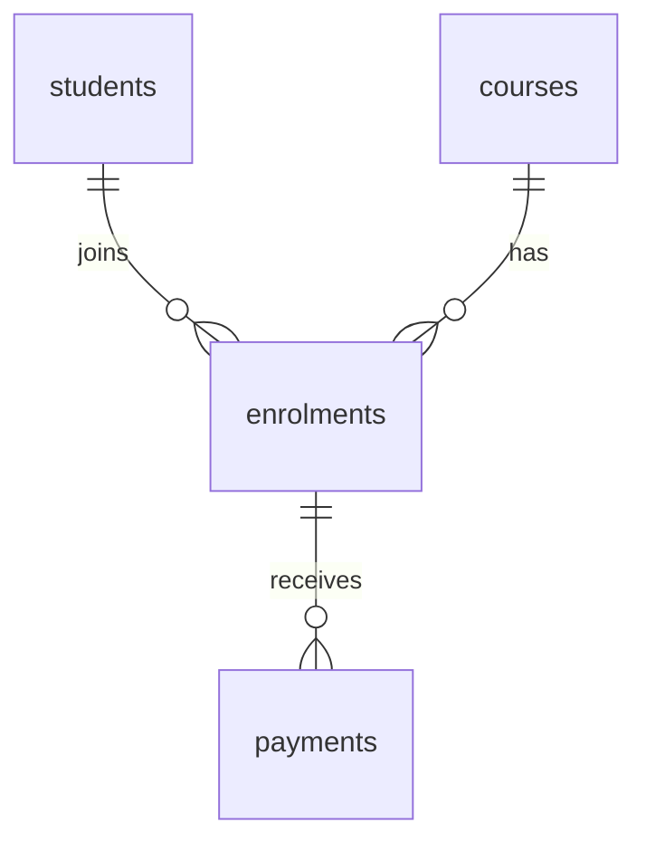

# SQL fundamentals with SQLite and Python

Adapted from the teaching material credited to **@kamos, 4 November 2026**.

Learn to ask useful questions of data, design related tables, and change records safely. Start with SQL in a database editor; add Python once you understand the queries. No database knowledge is assumed. Unit 7 assumes basic Python variables, tuples, functions, and exceptions.

## Learning path

| Unit | Main question | You will practise |
| --- | --- | --- |
| [1. Meet your data](#1-meet-your-data) | What does one row mean? | Tables, keys, SELECT |
| [2. Find useful records](#2-find-useful-records) | Which rows answer the question? | WHERE, NULL, sorting |
| [3. Turn records into reports](#3-turn-records-into-reports) | What should we count or total? | Aggregates, grouping, CASE |
| [4. Design a school database](#4-design-a-school-database) | Where should each fact live? | Relationships, constraints |
| [5. Change data safely](#5-change-data-safely) | Which records should change? | INSERT, UPDATE, DELETE, rollback |
| [6. Combine related tables](#6-combine-related-tables) | How do we report across tables? | INNER/LEFT JOIN, balances, subqueries |
| [7. Use SQL from Python](#7-use-sql-from-python) | How does a program use this safely? | Parameters, transactions, errors |
| [8. Build and verify](#8-build-and-verify) | Can we trust the result? | School project, views, indexes, backups |

Each lesson follows: **question → inspect data → predict → run SQL → explain → try a variation**. Exercises appear beside the topic. Try them before opening [SOLUTIONS.md](SOLUTIONS.md). [TEACHER_GUIDE.md](TEACHER_GUIDE.md) contains the session plan; [OPTIONAL_TOPICS.md](OPTIONAL_TOPICS.md) contains extensions.

## Set up the practice databases

Use a SQL editor such as DB Browser for SQLite. In its **Execute SQL** tab, open each supplied SQL file and run all its statements. Save/commit changes if your editor requests it.

| Database to create | Files to run, in order | Used in |
| --- | --- | --- |
| `shop_practice.db` | [sql/shop_setup.sql](sql/shop_setup.sql) | Units 1–3 and shop exercises |
| `school_practice.db` | [sql/school_schema.sql](sql/school_schema.sql), then [sql/school_seed.sql](sql/school_seed.sql) | Units 4–8 |

Create each as a **new empty database**, not an old `school.db`. Setup files do not upgrade old schemas. The shop begins with 9 products; the school has 4 students, 4 courses, 4 enrolments, and 4 payments. All records are fictional.

To reset: close the practice database, delete only that practice file, create a new empty one, and rerun its setup. Do not delete project or personal databases. Reset after experiments that change data; later expected results assume the original records.

SQL blocks in Units 1–6 run directly in the editor. Python blocks run as Python scripts. `?` parameters in Unit 7 are supplied by Python, not typed as literal values in the editor.

## 1. Meet your data

### 1.1 Database, SQL, and SQLite

A database stores organised data. A relational database represents data in tables and links related records using keys. SQL is the language used to query and change that data. SQLite is the database engine used here; Python's `sqlite3` module lets programs talk to it.

A shopkeeper's stock book answers “What do we sell?” A database can also answer “Which products are nearly finished?” and reject invalid changes.

| Word | Meaning | Example |
| --- | --- | --- |
| Table | Records of one kind | `products` |
| Row / record | One instance | One product |
| Column / field | One property | `stock_qty` |
| Primary key | Column(s) uniquely identifying a row | `product_id` |
| Foreign key | Column(s) referring to a declared key in another table | An enrolment's `student_id` |
| Schema | Tables, columns, relationships, and rules | The database design |
| Query | A request for data | Products low in stock |

**Always ask what one row represents.** Here it represents one product, not one sale or one individual item in stock. A product with `stock_qty = 40` still occupies one row.

### 1.2 Read a table

Open `shop_practice.db` and run:

```sql
SELECT product_id, name, price_ugx, stock_qty
FROM products
ORDER BY product_id;
```

The result is a table. `SELECT` chooses columns; `FROM` chooses the source. `ORDER BY` gives a defined order. `SELECT * FROM products;` shows every column and is useful for exploring; name the required columns in reports and programs.

The first three rows are:

| product_id | name | price_ugx | stock_qty |
| --- | --- | --- | --- |
| 1 | Rice 5kg | 22000 | 40 |
| 2 | Sugar 1kg | 5500 | 120 |
| 3 | Cooking oil 3L | 24000 | 25 |

Without `ORDER BY`, row order is not guaranteed. An ID identifies a record; it is not its screen position. IDs can have gaps.

SQL keywords are written in capitals here for readability. Text values use single quotes: `'Food'`. End editor statements with `;`.

**Exercise 1.** List every product's name and category in product ID order. How many rows should appear? Explain why stock quantities do not affect that count.

## 2. Find useful records

### 2.1 Filter with WHERE

Question: “What should the shopkeeper consider restocking?” Predict the names before running:

```sql
SELECT name, stock_qty
FROM products
WHERE stock_qty < 30
ORDER BY stock_qty, product_id;
```

| name | stock_qty |
| --- | --- |
| Earphones | 0 |
| Phone charger | 18 |
| Cooking oil 3L | 25 |

`WHERE` keeps rows whose condition is true.

| Operator | Purpose | Example |
| --- | --- | --- |
| `=`, `<>` | Equal, not equal | `category = 'Food'` |
| `<`, `<=`, `>`, `>=` | Compare | `stock_qty <= 30` |
| `AND`, `OR`, `NOT` | Combine conditions | `category = 'Food' AND stock_qty < 30` |
| `BETWEEN` | Inclusive range | `price_ugx BETWEEN 2000 AND 15000` |
| `IN` | One of several values | `category IN ('Food', 'Household')` |
| `LIKE` | Text pattern | `name LIKE '%oil%'` |
| `IS NULL` | Missing value | `phone IS NULL` |

For `LIKE`, `%` matches any number of characters; `_` matches one. SQLite's default case-insensitive behaviour covers ASCII letters, not every language's alphabet.

### 2.2 Parentheses change meaning

These requests are different:

```sql
-- All Food, plus only Household products with stock below 30.
SELECT name FROM products
WHERE category = 'Food'
   OR category = 'Household' AND stock_qty < 30
ORDER BY name;

-- Only low-stock products, in either category.
SELECT name FROM products
WHERE (category = 'Food' OR category = 'Household')
  AND stock_qty < 30
ORDER BY name;
```

`AND` takes priority over `OR`. The first query returns the three Food products; the second returns only Cooking oil 3L. Use parentheses to make your intention clear.

### 2.3 Sort, limit, and remove duplicates

```sql
SELECT name, price_ugx
FROM products
ORDER BY price_ugx DESC, product_id
LIMIT 3;

SELECT DISTINCT category
FROM products
ORDER BY category;
```

The top prices are Cooking oil 3L (24000), Rice 5kg (22000), and Phone charger (15000). `DISTINCT` returns each category once. For pagination, `LIMIT 3 OFFSET 3` skips three rows and returns the next three. Keep a unique tie-breaker such as `product_id` in the ordering.

### 2.4 Missing does not mean zero

`NULL` means missing, unknown, or not applicable. It differs from `0` and from empty text `''`.

- Zero stock means we know there are none.
- A `NULL` phone means no phone value was recorded.
- An empty string is a recorded text value with no characters.

Use `IS NULL` and `IS NOT NULL`, not `= NULL`. Comparisons such as `phone <> '0771234567'` also exclude missing phones: the comparison is unknown, not true. Arithmetic involving `NULL` generally returns `NULL`. Use `COALESCE(value, replacement)` only when the replacement makes sense for the question.

**Exercise 2.** List products costing between UGX 2,000 and UGX 15,000, cheapest first, with product ID as a tie-breaker. Predict how many qualify.

**Exercise 3.** Find product names containing `Cooking`. Then find products that are either Food or Household **and** have stock below 30. Explain your parentheses.

## 3. Turn records into reports

### 3.1 Calculate values

Question: “How much money is tied up in each product's stock?”

```sql
SELECT name, price_ugx * stock_qty AS stock_value_ugx
FROM products
ORDER BY stock_value_ugx DESC, product_id;
```

`AS` names a result column. Rice stock is worth UGX 880,000. Earphones have a price but zero stock value. This is stock valued at the listed price; it is not sales revenue or profit.

### 3.2 Summarise rows

| Function | Meaning |
| --- | --- |
| `COUNT(*)` | Count result rows |
| `COUNT(column)` | Count non-NULL values |
| `SUM(column)` | Add non-NULL values |
| `AVG(column)` | Average non-NULL values |
| `MIN(column)`, `MAX(column)` | Smallest, largest non-NULL value |

```sql
SELECT COUNT(*) AS products,
       SUM(price_ugx * stock_qty) AS total_stock_value_ugx
FROM products;
```

Expected: **9 products; UGX 4,150,000**. Aggregates summarise many input rows. `COUNT` returns zero for an empty input; `SUM` returns `NULL` when there are no non-NULL values. Use `COALESCE(SUM(...), 0)` when an empty total should mean zero.

### 3.3 GROUP BY and HAVING

Question: “How much stock value belongs to each category?” One output row should represent **one category**.

```sql
SELECT category,
       COUNT(*) AS products,
       SUM(price_ugx * stock_qty) AS stock_value_ugx
FROM products
GROUP BY category
ORDER BY stock_value_ugx DESC, category;
```

| category | products | stock_value_ugx |
| --- | --- | --- |
| Food | 3 | 2140000 |
| Household | 2 | 1040000 |
| Stationery | 2 | 700000 |
| Electronics | 2 | 270000 |

`WHERE` filters input rows; `HAVING` filters the resulting groups:

```sql
SELECT category, SUM(price_ugx * stock_qty) AS stock_value_ugx
FROM products
WHERE stock_qty > 0
GROUP BY category
HAVING SUM(price_ugx * stock_qty) > 1000000
ORDER BY category;
```

Expected: Food and Household. The zero-stock Earphones row is excluded before grouping. In aggregate examples, group every selected column that is not aggregated; avoid relying on SQLite's permissive selection of ungrouped columns.

A useful logical model is: **FROM/JOIN → WHERE → GROUP BY → HAVING → SELECT → DISTINCT → ORDER BY → LIMIT**. This explains the result; it is not a promise about the engine's physical execution plan.

### 3.4 CASE labels a result

```sql
SELECT name,
       CASE
           WHEN stock_qty = 0 THEN 'Out of stock'
           WHEN stock_qty < 30 THEN 'Low stock'
           ELSE 'OK'
       END AS stock_status
FROM products
ORDER BY product_id;
```

The first matching branch wins. `CASE` computes a result; it does not change the table.

**Exercise 4.** Show each category's product count and average price, rounded to a whole shilling. Sort by category.

**Exercise 5.** Show only categories whose stock value exceeds UGX 500,000. Explain why the total condition belongs in `HAVING`.

## 4. Design a school database

### 4.1 Turn a spreadsheet into tables

Imagine this sheet:

| Student | Phone | Course | Advertised fee |
| --- | --- | --- | --- |
| Aisha Nakato | 0771234567 | Python Basics | 300000 |
| Aisha Nakato | 0771234567 | Web Development | 450000 |
| Brian Okello | 0759876543 | Python Basics | 300000 |

Aisha's phone and the Python fee are repeated. Changing one copy can leave contradictory records. Deleting the last enrolment could also erase the only information about a course. These are update and deletion anomalies.

Split facts according to what they describe:

| Table | One row represents | Important facts |
| --- | --- | --- |
| `students` | One student | Name, contact details |
| `courses` | One course | Title, current advertised fee |
| `enrolments` | One student joining one course | Student ID, course ID, agreed fee |
| `payments` | One payment towards an enrolment | Amount, date, method |



One student can have many enrolments. One course can have many enrolments. Students and courses therefore have a many-to-many relationship, implemented through `enrolments`. One enrolment can have zero or many payments; each payment must belong to one enrolment.

### 4.2 Normalisation in plain language

- **First normal form:** store one value per cell; do not put `'Python, Web'` in a course field.
- **Second normal form:** a fact should depend on the whole key. In a student/course link, the student's phone depends only on the student; move it to `students`.
- **Third normal form:** facts about another entity belong with that entity. Store the current course title and price in `courses`, not repeatedly with each student.

An **agreed enrolment fee** is a separate historical fact. If the advertised price rises next term, it should not change an existing student's debt. A balance is calculated from agreed fee minus payments; storing it again would create another value to keep synchronised.

Use generated IDs to link records, not names: different students can have the same name.

### 4.3 Types and rules

SQLite commonly stores integers, real numbers, text, bytes (`BLOB`), and `NULL`. Store phone numbers as text to preserve leading zeroes. Store whole-shilling UGX amounts as integers. Store dates as ISO text (`YYYY-MM-DD`) so they sort correctly.

Ordinary SQLite columns use type affinity rather than strict type enforcement. A column declaration alone is not complete validation. `STRICT` tables are an optional extension; date text also needs format validation when accepting input.

```sql
-- This table is already in school_schema.sql; inspect it here.
CREATE TABLE IF NOT EXISTS payments (
    payment_id INTEGER PRIMARY KEY,
    enrolment_id INTEGER NOT NULL REFERENCES enrolments(enrolment_id),
    amount_ugx INTEGER NOT NULL CHECK (amount_ugx > 0),
    paid_on TEXT NOT NULL DEFAULT (date('now', 'localtime')),
    method TEXT NOT NULL DEFAULT 'cash'
);
```

| Rule | Purpose |
| --- | --- |
| `INTEGER PRIMARY KEY` | Unique row ID; SQLite supplies one if omitted |
| `NOT NULL` | A value must be supplied or provided by a default |
| `UNIQUE` | Prevent duplicate non-NULL values |
| `DEFAULT` | Supply a value when the column is omitted |
| `CHECK` | Reject a false condition |
| `REFERENCES` / foreign key | Require a matching parent key |

`NOT NULL` does not reject empty text; the shared schema also checks trimmed names. `CHECK` permits a NULL result, so use `NOT NULL` for required amounts. `UNIQUE(email)` permits multiple missing emails. `AUTOINCREMENT` is usually unnecessary and does not guarantee gap-free IDs.

Run `PRAGMA foreign_keys = ON;` on **every connection**, before starting a transaction. The setup file enables it for its connection; reopening the file requires enabling it again.

### 4.4 Know the model's boundaries

Our small academy permits one enrolment per student/course pair and assumes a single local computer's date. A later extension can add course offerings or terms to allow repeat enrolments. We retain financial history: parent deletes with linked records are blocked by the default foreign-key action; the project deactivates students instead.

`IF NOT EXISTS` avoids creating an existing table again. It does **not** add new columns to that table. `ALTER TABLE students ADD COLUMN address TEXT;` changes structure; `DROP TABLE students;` removes the table and its records. Practise schema changes in a disposable database.

**Exercise 6.** Sketch a library with books, members, and loans. State what one row means, identify primary and foreign keys, and explain where a return date belongs. Then explain why copying a student's phone into every enrolment is a poor design.

## 5. Change data safely

Use `school_practice.db`; enable foreign keys first. For editor experiments, use an explicit transaction and undo it:

```sql
PRAGMA foreign_keys = ON;
BEGIN;
INSERT INTO students (full_name, email, phone)
VALUES ('Esther Auma', 'esther@example.com', '0702222222');
SELECT student_id, full_name FROM students ORDER BY student_id;
ROLLBACK;
```

The row appears inside the transaction and disappears after `ROLLBACK`. Use `COMMIT` instead when you deliberately want to retain changes. A transaction groups changes into one unit: commit all of them or undo them. Do not leave it open while waiting for user input.

### 5.1 INSERT linked records

This uses known seed IDs to demonstrate one enrolment and two instalments. Predict the balance before running. The `INSERT ... SELECT` copies the advertised fee at the time of enrolment.

```sql
BEGIN;
INSERT INTO enrolments (student_id, course_id, agreed_fee_ugx)
SELECT 4, course_id, fee_ugx FROM courses WHERE course_id = 4;
-- Inspect the assigned enrolment ID; it is 5 in the untouched seed data.
SELECT enrolment_id FROM enrolments WHERE student_id = 4 AND course_id = 4;
INSERT INTO payments (enrolment_id, amount_ugx) VALUES (5, 30000);
INSERT INTO payments (enrolment_id, amount_ugx) VALUES (5, 20000);
SELECT * FROM v_fee_balances WHERE enrolment_id = 5;
ROLLBACK;
```

Expected: fee 100000, paid 50000, balance 50000. Programs should retrieve the generated ID, rather than assuming the next number (Unit 7).

### 5.2 UPDATE and DELETE

Preview with the same condition before changing rows. Use a primary key when targeting one record:

```sql
SELECT student_id, full_name, phone FROM students WHERE student_id = 2;
BEGIN;
UPDATE students SET phone = '0709999999' WHERE student_id = 2;
SELECT student_id, full_name, phone FROM students WHERE student_id = 2;
ROLLBACK;
```

`DELETE FROM students WHERE student_id = 4;` would remove David, who has no enrolments in the seed. `DELETE FROM students;` targets **every** student, subject to constraints. A missing `WHERE` is a serious mistake.

Deactivation preserves history:

```sql
BEGIN;
UPDATE students SET is_active = 0 WHERE student_id = 2;
SELECT full_name FROM students WHERE is_active = 1 ORDER BY full_name;
ROLLBACK;
```

### 5.3 Rules that need more than a column CHECK

A positive payment can still exceed the amount owed. The rule compares records across tables, so `CHECK(amount_ugx > 0)` is only part of the protection. The project uses one conditional insert to check the balance and record the payment together. Transactions also matter when a sale changes stock and creates a receipt.

**Exercise 7.** In `shop_practice.db`, reduce Phone charger stock by 3 only if at least 3 remain available. Preview, update, inspect, and roll back. What condition prevents negative stock?

**Exercise 8.** In the school database, change Python Basics' advertised fee to 350000 inside a transaction. Compare it with Aisha's agreed fee and balance in `v_fee_balances`, then roll back. Explain why her balance stays zero.

## 6. Combine related tables

Reset school practice data if earlier changes were committed. Confirm `PRAGMA foreign_keys = ON;`.

### 6.1 INNER JOIN finds matching records

Question: “Who enrolled in which course?” One result row represents **one enrolment**.

```sql
SELECT e.enrolment_id, s.full_name, c.title
FROM enrolments AS e
JOIN students AS s ON s.student_id = e.student_id
JOIN courses AS c ON c.course_id = e.course_id
ORDER BY e.enrolment_id;
```

| enrolment_id | full_name | title |
| --- | --- | --- |
| 1 | Aisha Nakato | Python Basics |
| 2 | Aisha Nakato | Web Development |
| 3 | Brian Okello | Python Basics |
| 4 | Carol Namubiru | Data Analysis |

`AS s` gives a table a short alias. The `ON` condition matches keys. David is absent because he has no enrolment. Aisha appears twice because she has two; this is correct, not an error to hide with `DISTINCT`.

### 6.2 LEFT JOIN keeps unmatched records

Question: “Which students need enrolment follow-up?”

```sql
SELECT s.full_name
FROM students AS s
LEFT JOIN enrolments AS e ON e.student_id = s.student_id
WHERE e.enrolment_id IS NULL
ORDER BY s.student_id;
```

Expected: David Ssemwogerere. A left join keeps left-hand rows even without a match, filling right-hand fields with NULL.

For “all students, with any Web Development enrolment”, put the course condition in `ON`:

```sql
SELECT s.full_name, e.enrolment_id
FROM students AS s
LEFT JOIN enrolments AS e
  ON e.student_id = s.student_id AND e.course_id = 2
ORDER BY s.student_id;
```

All four students remain; only Aisha has a matching enrolment ID. Moving `e.course_id = 2` into `WHERE` would remove the unmatched students.

### 6.3 Inspect joined rows before counting

Aisha's Python enrolment has **two payments**. Joining them produces two rows containing the same agreed fee:

```sql
SELECT e.enrolment_id, e.agreed_fee_ugx, p.payment_id, p.amount_ugx
FROM enrolments e
LEFT JOIN payments p ON p.enrolment_id = e.enrolment_id
WHERE e.enrolment_id = 1
ORDER BY p.payment_id;
```

| enrolment_id | agreed_fee_ugx | payment_id | amount_ugx |
| --- | --- | --- | --- |
| 1 | 300000 | 1 | 100000 |
| 1 | 300000 | 2 | 200000 |

Summing the repeated fee would incorrectly produce 600000. Sum payments at the enrolment level, and select its agreed fee once. Joining two separate one-to-many tables can multiply rows again: aggregate each separately before combining their totals.

### 6.4 Build a fee balance report

```sql
SELECT e.enrolment_id, s.full_name, c.title, e.agreed_fee_ugx,
       COALESCE(SUM(p.amount_ugx), 0) AS paid_ugx,
       e.agreed_fee_ugx - COALESCE(SUM(p.amount_ugx), 0) AS balance_ugx
FROM enrolments e
JOIN students s ON s.student_id = e.student_id
JOIN courses c ON c.course_id = e.course_id
LEFT JOIN payments p ON p.enrolment_id = e.enrolment_id
GROUP BY e.enrolment_id, s.full_name, c.title, e.agreed_fee_ugx
ORDER BY e.enrolment_id;
```

| enrolment_id | Student / course | agreed_fee_ugx | paid_ugx | balance_ugx |
| --- | --- | --- | --- | --- |
| 1 | Aisha / Python Basics | 300000 | 300000 | 0 |
| 2 | Aisha / Web Development | 450000 | 200000 | 250000 |
| 3 | Brian / Python Basics | 300000 | 150000 | 150000 |
| 4 | Carol / Data Analysis | 400000 | 0 | 400000 |

`COALESCE` changes an absent payment total to zero; it keeps Carol's balance calculable. To show only outstanding balances, add `HAVING e.agreed_fee_ugx - COALESCE(SUM(p.amount_ugx), 0) > 0` before `ORDER BY`.

### 6.5 COUNT with a left join

```sql
SELECT c.title, COUNT(*) AS joined_rows,
       COUNT(e.enrolment_id) AS enrolments
FROM courses c
LEFT JOIN enrolments e ON e.course_id = c.course_id
GROUP BY c.course_id, c.title
ORDER BY c.course_id;
```

Digital Literacy has `joined_rows = 1` but `enrolments = 0`: the preserved course row has a NULL enrolment ID. Counting a non-NULL child key counts actual matching records.

### 6.6 A subquery answers an intermediate question

Question: “Which products cost more than the average product price?” In the shop database:

```sql
SELECT name, price_ugx
FROM products
WHERE price_ugx > (SELECT AVG(price_ugx) FROM products)
ORDER BY price_ugx DESC, product_id;
```

The inner query calculates one average; the outer query uses it to filter products. In the school database, `NOT EXISTS` asks whether a related record is absent:

```sql
SELECT s.full_name
FROM students s
WHERE NOT EXISTS (
    SELECT 1 FROM enrolments e WHERE e.student_id = s.student_id
)
ORDER BY s.student_id;
```

Again, only David qualifies. Avoid replacing this mechanically with `NOT IN` when the inner result might contain NULL.

**Exercise 9.** Show all courses and their enrolment counts, including zero. Then explain why `COUNT(*)` gives the wrong answer for Digital Literacy.

**Exercise 10.** List students with no payments at all, including students who have never enrolled. Expected names: Carol and David. Explain why Aisha's multiple payments must not produce multiple student rows.

## 7. Use SQL from Python

### 7.1 Connect, execute, fetch, close

Use Python 3.10 or later. Check availability with `python -c "import sqlite3; print(sqlite3.sqlite_version)"` (use `python3` if needed). SQLite normally comes with Python; a distribution can omit this module.

Save practice scripts in the repository folder. `Path(__file__)` refers to a saved script; in an interactive notebook, use an explicit path instead.

```python
from contextlib import closing
from pathlib import Path
import sqlite3

path = Path(__file__).parent / 'school_practice.db'
if not path.is_file():
    raise FileNotFoundError('Create the school practice database first')

with closing(sqlite3.connect(path)) as conn:
    conn.row_factory = sqlite3.Row
    conn.execute('PRAGMA foreign_keys = ON')
    cur = conn.execute(
        'SELECT full_name, phone FROM students WHERE student_id = ?', (1,)
    )
    row = cur.fetchone()
    if row is None:
        print('Student not found')
    else:
        print(row['full_name'], row['phone'])
```

A connection manages the database session. A cursor runs statements and retrieves results; `conn.execute()` returns a cursor without needing a separate `conn.cursor()` call.

| Method | Result |
| --- | --- |
| `fetchone()` | Next row, or `None` |
| `fetchmany(n)` | Up to n remaining rows |
| `fetchall()` | All remaining rows as a list |
| `for row in cur:` | Iterate through remaining rows |

Fetching consumes rows: a second `fetchall()` may return an empty list. Set `row_factory` before creating cursors to access columns by name. `sqlite3.Row` is not a plain dictionary; `dict(row)` converts it.

### 7.2 Parameters keep values separate from SQL

```python
def search_products(conn, term):
    return conn.execute(
        'SELECT name, price_ugx FROM products WHERE name LIKE ? ORDER BY name',
        (f'%{term}%',),
    ).fetchall()
```

The comma makes `(value,)` a one-item tuple. Percent signs belong in the parameter value; do not insert an extra space before the search term.

Never construct SQL by inserting user values into its text. For example, `f"SELECT * FROM students WHERE full_name = '{name}'"` lets malicious input such as `x' OR '1'='1` change the query. Placeholders treat it as data, and also handle apostrophes such as O'Connor safely.

Parameters stand for **values**, not table or column names. For a dynamic sort column, select it from a fixed allowed mapping before constructing the SQL. The ordinary examples here use fixed column names.

### 7.3 Commit a complete operation

These examples use Python's legacy transaction control, available in Python 3.10+. In Python 3.12+, it can be selected explicitly with `autocommit=sqlite3.LEGACY_TRANSACTION_CONTROL`. Other transaction modes behave differently; see the official reference below.

Under this mode, modifying statements such as INSERT and UPDATE start a transaction automatically. `with conn:` commits on normal exit or rolls back if an exception escapes. **It does not close the connection or start a transaction just by entering the block.** Use `closing(...)` or `finally: conn.close()` to close it.

```python
def register_student(conn, full_name, email=None):
    full_name = full_name.strip()
    if not full_name:
        raise ValueError('Name is required')
    email = (email.strip().lower() or None) if email else None
    with conn:
        cur = conn.execute(
            'INSERT INTO students (full_name, email) VALUES (?, ?)',
            (full_name, email),
        )
    return cur.lastrowid
```

Retrieve the generated ID using `lastrowid`; use it for linked records. For several inserts, `executemany(sql, rows)` inside one `with conn:` block is convenient. If a row fails, let the exception leave the block so the earlier rows are rolled back too. Catch it outside.

### 7.4 A transfer must succeed together

Run this standalone script with its own temporary database:

```python
from contextlib import closing
import sqlite3


def transfer(conn, sender, receiver, amount):
    if type(amount) is not int or amount <= 0 or sender == receiver:
        raise ValueError('Use a positive whole amount and different wallets')
    with conn:
        debit = conn.execute(
            'UPDATE wallets SET balance = balance - ? WHERE owner = ?',
            (amount, sender),
        )
        credit = conn.execute(
            'UPDATE wallets SET balance = balance + ? WHERE owner = ?',
            (amount, receiver),
        )
        if debit.rowcount != 1 or credit.rowcount != 1:
            raise ValueError('Both wallets must exist')


with closing(sqlite3.connect(':memory:')) as conn:
    conn.execute('''CREATE TABLE wallets (
        owner TEXT PRIMARY KEY NOT NULL,
        balance INTEGER NOT NULL CHECK (balance >= 0)
    )''')
    with conn:
        conn.executemany('INSERT INTO wallets VALUES (?, ?)',
                         [('Aisha', 100000), ('Brian', 20000)])
    transfer(conn, 'Aisha', 'Brian', 50000)
    try:
        transfer(conn, 'Aisha', 'Brian', 900000)
    except sqlite3.IntegrityError:
        print('Insufficient funds; transfer rolled back')
    print(conn.execute('SELECT * FROM wallets ORDER BY owner').fetchall())
```

Expected balances: Aisha 50000; Brian 70000. A failed statement does not always undo all earlier work by itself; the transaction context handles rollback when the exception escapes.

### 7.5 Read useful errors

| Error | Likely cause | First check |
| --- | --- | --- |
| `IntegrityError` | UNIQUE, CHECK, NOT NULL, or foreign-key violation | Values and schema rules |
| `OperationalError: no such table` | Wrong file or missing setup | Database path and setup files |
| `OperationalError: database is locked` | Another connection has a conflicting transaction | Save/rollback pending editor work; keep transactions short |
| `ProgrammingError: Incorrect number of bindings` | Parameters do not match placeholders | Count values; check the one-item tuple comma |

Catch specific exceptions. Show users a clear message; retain useful technical detail while avoiding unnecessary personal data in logs. `timeout=10` can wait longer for a lock but cannot fix an indefinitely open transaction. SQLite has one writer at a time; WAL does not change that.

**Exercise 11.** Write a Python search function using placeholders and demonstrate a search for `Cooking`. Test that a name containing an apostrophe can be inserted safely. Use the shop helper described in the README for the product data.

**Exercise 12.** In the transfer script, try a transfer from Aisha to a nonexistent wallet. Catch the error outside the call and prove both existing balances remain unchanged. Why is this a stronger rollback demonstration than an insufficient-funds failure at the first update?

## 8. Build and verify

### 8.1 Guided project: School Manager

Run `python school_manager.py`. It creates `school_project.db` beside the script, using the shared [schema](sql/school_schema.sql), and starts a text menu. This project database is separate from `school_practice.db`. It begins with courses but no students or payments.

Start by implementing or reading only these functions:

1. `get_connection` and `init_db`: enable foreign keys and create the schema.
2. `add_student`: insert validated values and return the generated ID.
3. `enrol`: copy the current course fee into `agreed_fee_ugx`.
4. `record_payment`: record a positive payment only if the remaining balance permits it.
5. `outstanding_balances`: show what is owed.

The menu and CSV formatting are supplied support code. Students should explain the SQL before extending the interface. Inspect how the conditional payment insert avoids a separate check followed by an unprotected insert.

The simplified project blocks overpayments through its payment function. Direct SQL can bypass that application rule. Do not claim that the amount CHECK alone enforces the remaining balance.

### 8.2 Views save report logic

The shared schema saves the balance report as `v_fee_balances`. A view is a named query; SQLite views are normally read-only and do not store a separate snapshot of results.

```sql
SELECT full_name, title, fee_ugx, paid_ugx, balance_ugx
FROM v_fee_balances
WHERE balance_ugx > 0
ORDER BY balance_ugx DESC, enrolment_id;
```

In the seeded practice database, Carol owes 400000, Aisha owes 250000 for Web Development, and Brian owes 150000. Total outstanding: **800000**. A changed advertised fee does not change those historical enrolment fees.

### 8.3 Check correctness with known data

Try the project functions in a temporary database:

```python
from contextlib import closing
from school_manager import (get_connection, init_db, add_student, enrol,
                            record_payment, get_balance)

with closing(get_connection(':memory:')) as conn:
    init_db(conn)
    sid = add_student(conn, 'Test Student', 'test@example.com')
    eid = enrol(conn, sid, 1)
    assert get_balance(conn, eid) == 300000
    assert record_payment(conn, eid, 100000) is True
    assert get_balance(conn, eid) == 200000
    assert record_payment(conn, eid, 999999) is False
    assert get_balance(conn, eid) == 200000
    with conn:
        conn.execute('UPDATE courses SET fee_ugx = 350000 WHERE course_id = 1')
    assert get_balance(conn, eid) == 200000
print('Payment and historical fee checks passed')
```

Also test duplicate emails, invalid parent IDs, and students with no payments. Explain what each check proves; passing one happy-path example is not enough.

### 8.4 Basic indexes

An index can speed up lookups, at a cost in storage and write work. UNIQUE constraints already create supporting indexes; do not add another index to the unique email column just to demonstrate speed.

In a **fresh temporary editor database**, compare plans using a non-unique field:

```sql
CREATE TABLE people (person_id INTEGER PRIMARY KEY, town TEXT);
INSERT INTO people (town) VALUES ('Kampala'), ('Gulu'), ('Mbale');
EXPLAIN QUERY PLAN SELECT person_id FROM people WHERE town = 'Gulu';
CREATE INDEX idx_people_town ON people(town);
EXPLAIN QUERY PLAN SELECT person_id FROM people WHERE town = 'Gulu';
```

The first plan scans the table; the second can search using the index. Plan wording and choices can vary. Small examples teach the idea; measure representative workloads before adding indexes to real applications.

### 8.5 Back up and restore

Use SQLite's backup API for an open database, rather than copying a potentially changing file:

```python
from contextlib import closing
from pathlib import Path
import sqlite3

source = Path(__file__).parent / 'school_project.db'
if not source.is_file():
    raise FileNotFoundError('Run School Manager first')
with closing(sqlite3.connect(source)) as src:
    with closing(sqlite3.connect(source.with_name('school_project_backup.db'))) as dst:
        src.backup(dst)
```

This fixed backup name replaces the previous backup's contents; the project menu creates timestamped backups. Practise opening a backup and checking a known record. Keep real backups in a second location too.

### 8.6 Independent assignment

Choose a small library, shop receipt, attendance, or expense system. Submit:

- A diagram and the meaning of one row in each table.
- A schema with primary keys, foreign keys, and appropriate constraints.
- Fictional sample records, including an unmatched parent and multiple child rows.
- Working create/read/update/delete operations (explain where deactivation is appropriate).
- Two joined or grouped reports, with expected results calculated by hand.
- A transaction for a multi-step change, safe parameters, and a short README.

Mark out of 20: design/rules 4; working operations 4; safe parameters 3; correct reports with explanations 4; transaction/error handling 3; readable code/setup 2. Advanced features earn no automatic extra credit: correct, explainable fundamentals come first.

The [coffee farm example](coffee_farm.py) is an optional second context. State its assumptions before extending it; see [OPTIONAL_TOPICS.md](OPTIONAL_TOPICS.md).

## Quick reference

| Need | Pattern |
| --- | --- |
| Choose records | `SELECT name FROM products WHERE stock_qty < 30;` |
| Sort | `ORDER BY price_ugx DESC, product_id` |
| Missing values | `IS NULL` / `IS NOT NULL` |
| Group | `GROUP BY category HAVING COUNT(*) > 1` |
| Match related rows | `JOIN courses c ON c.course_id = e.course_id` |
| Keep unmatched parents | `LEFT JOIN ... ON ...` |
| Insert | `INSERT INTO students (full_name) VALUES ('Faith Akello');` |
| Change | `UPDATE students SET phone = '0700000000' WHERE student_id = 1;` |
| Remove | `DELETE FROM students WHERE student_id = 4;` |
| Commit / undo | `COMMIT;` / `ROLLBACK;` |
| Inspect columns | `PRAGMA table_info(students);` |
| Check a plan | `EXPLAIN QUERY PLAN SELECT ...;` |

Before trusting a report, ask: **What does one result row mean? Which records are excluded? Could the join duplicate a value? Does the answer match a small example checked by hand?**

## References

- [SQLite SELECT: grouping, joins, ordering](https://www.sqlite.org/lang_select.html)
- [SQLite expressions: NULL, operators, LIKE](https://www.sqlite.org/lang_expr.html)
- [SQLite table constraints](https://www.sqlite.org/lang_createtable.html)
- [SQLite foreign keys](https://www.sqlite.org/foreignkeys.html)
- [Python sqlite3 and transaction control](https://docs.python.org/3/library/sqlite3.html)
- [SQLite autoincrement](https://www.sqlite.org/autoinc.html)
